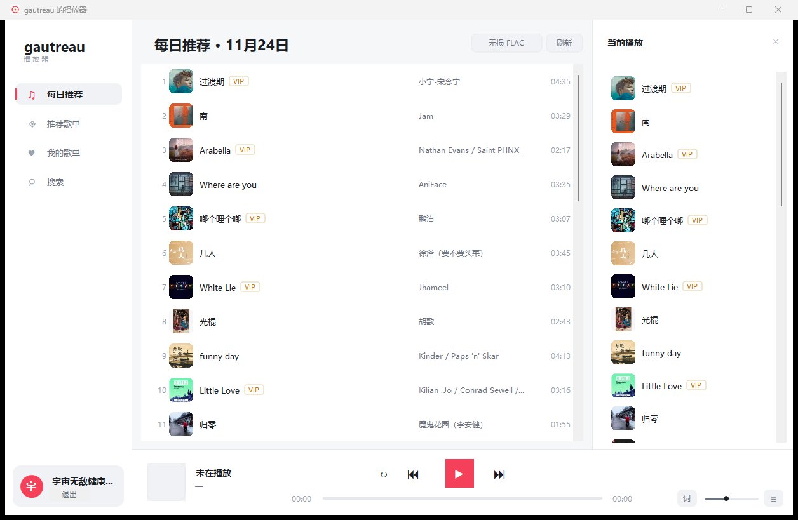

# gautreau 的播放器

一个轻量的网易云音乐桌面播放器，用 C# WinForms + Windows 媒体基础写成。单文件 **4.9 MB**，常驻内存 **65 MB** 左右，对比官方客户端 400 MB 以上。



## 它解决什么问题

官方 PC 客户端越来越重，启动慢、内存高、后台常驻。而第三方播放器（YesPlayMusic 那类）大多是 Electron 套壳，打包 150 MB 起，内存和官方客户端不相上下。

这个项目的做法是：界面用 GDI+ 自绘，音频解码交给 Windows 自带的媒体基础（Media Foundation），不内嵌浏览器内核，也不打包解码器。所以体积和内存都是数量级的差距。

## 功能

每日推荐、推荐歌单、我的歌单、搜索（单曲/专辑/歌手/歌单四类）、歌词滚动、播放列表、音质切换、循环模式。

音质支持 标准 / 较高 / 极高 / 无损 / Hi-Res / 高清环绕声，实测黑胶 VIP 账号可以拿到 FLAC 1632 kbps 和 2778 kbps。

## 技术要点

**接口层**用的是 `music.163.com/api/*` 明文通道，不需要 weapi/eapi 的 AES+RSA 签名，所以没有任何加密代码和第三方接口库依赖。

**登录**有两个入口：一是复用本机网易云客户端的会话（CEF 的 `v10` 格式 cookie + DPAPI 密钥 + SQLite，见 `ClientSession.cs`），二是内嵌 WebView2 打开网易官方登录页扫码或验证码。后者是因为裸 HTTP 客户端会被风控——网易的登录接口要求一套由页面 JS 运行时生成的设备指纹 cookie，纯 HTTP 请求首页服务端下发 0 个 cookie，构造不出来。

**音频输出**走 WASAPI 共享模式，与官方客户端同一条路径。音量在采样数据层做增益（`VolumeSampleProvider`），**绝不触碰设备或会话音量**——`WaveOut.Volume` / `WasapiOut.Volume` 改的是系统级别的音量，每次切歌新建输出对象都会重置它，会造成音量大跳。

**JSON 解析**必须容错。`JsonNode.Parse` 是惰性的，解析时不建属性字典，等第一次取属性才建，那时撞到重复键才抛异常。网易部分接口（比如私人雷达歌单）确实会返回重复的 `creator` 字段。所以解析后要立刻递归访问整棵树，把惰性字典提前逼出来（`NcmApi.SafeParse`）。

## 构建

需要 .NET 9 SDK。

```
dotnet publish -c Release -o app
```

产物是 `app/gautreau-player.exe`，单文件，可任意移动。依赖 .NET 9 运行时和 WebView2 运行时（Win10 1809+ 通常自带）。

## 自检

改完代码先跑这两条，能挡住绝大多数低级错误：

```
gautreau-player.exe --selftest    # 17 项数据接口，结果写到 %LOCALAPPDATA%\NcmLite\selftest.txt
gautreau-player.exe --uitest      # 各视图切换 + 播放，结果看 app.log
```

## 目录

```
*.cs            程序源码
NcmNative.csproj
app.manifest    DPI 感知与兼容性声明
tools/          辅助脚本（从客户端 Cookie 库提取会话，Python）
docs/           截图
```

## 已知限制

音质缺失这是账号权限不是程序问题，登陆更高级的vip就会有更高级的音质选项。

一起听、云盘、播客、MV、评论区、动态这些没有对应的 web 接口，做不了。

网易哪天改了接口或者收紧了风控，需要跟着改。这是这类项目的长期成本。

## 免责

仅供个人学习与自用。读取客户端本地会话的功能只应用于你自己已登录的账号，请勿用于他人设备。使用第三方客户端可能违反网易云音乐的用户协议，风险自负。
